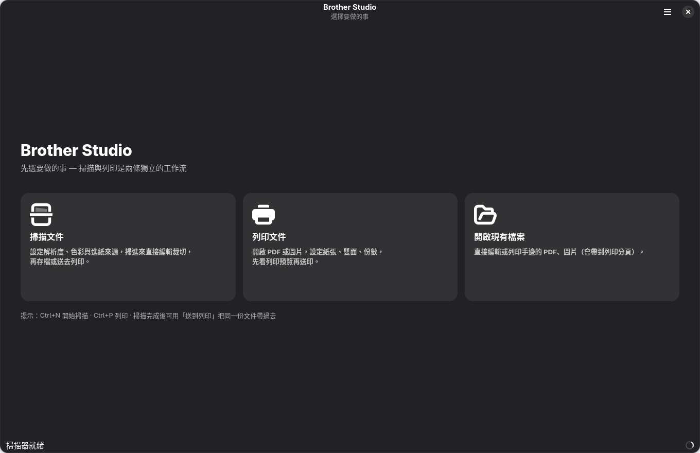
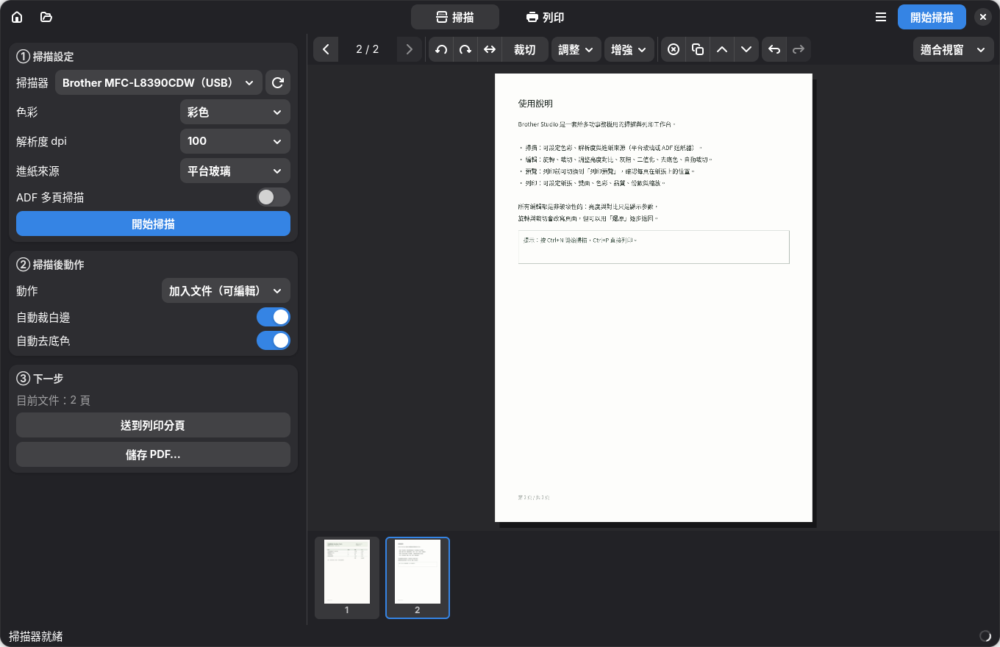
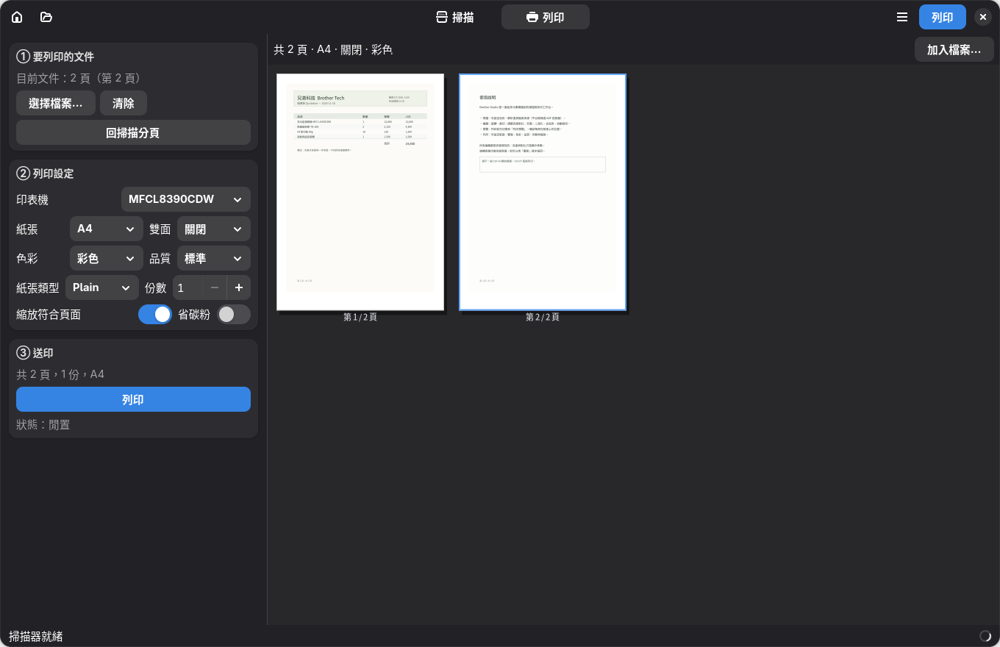

# brother-mfcl8390cdw-linux

在 **Arch / CachyOS / Manjaro** 等沒有 `rpm` / `dpkg` 的發行版上，安裝
**Brother MFC-L8390CDW** 彩色雷射多功能事務機的完整驅動（列印 + 掃描 + 掃描鍵 + PC-FAX），
外加一個掃描／編輯／列印的圖形介面。

> **English TL;DR** — Brother's official Linux installer only supports `rpm`/`dpkg`
> distros, so it fails outright on Arch-based systems. This project extracts the official
> Brother RPMs, re-runs exactly what their `postinst` scripts do, fixes two packaging bugs
> that break Arch, and ships a GTK4 GUI for scan → edit → print.
> ```bash
> git clone https://github.com/limOvO/brother-mfcl8390cdw-linux
> cd brother-mfcl8390cdw-linux
> ./scripts/fetch-drivers.sh
> sudo ./scripts/install.sh
> ./scripts/install-desktop.sh   # optional GUI launcher
> ```



[](https://github.com/limOvO/brother-mfcl8390cdw-linux/actions/workflows/ci.yml)

---

## 這個專案解決什麼問題

Brother 官方有 Linux 驅動，但他們的安裝程式 `linux-brprinter-installer` 只認 `rpm` 和 `dpkg`：

```
$ ./linux-brprinter-installer MFC-L8390CDW
  Rpm or dpkg is required.
```

Arch 系沒有這兩個工具，官方支援頁面也只提供 rpm / deb 套件，所以整台機器在 Arch 上等於廢掉。

更麻煩的是**就算把 rpm 硬裝進去也不會好用**，因為官方套件有兩個在 Arch 上必踩的雷（詳見
[怎麼運作的](docs/HOW-IT-WORKS.md)）：

| 問題 | 症狀 |
| --- | --- |
| `libLxBsScanCoreApi.so` 的版本連結寫錯（`.so.1` vs 正確的 `.so.3`） | `scanimage` 找不到掃描器，SANE backend 載入失敗 |
| Brother 的 udev rule 依賴某條 libsane 規則，Arch 的 `65-sane.rules` 沒有那條 | 一般使用者無法 USB 掃描（只有 root 能用） |

另外 CUPS 自動建立的 driverless 佇列 `document-format-default=application/octet-stream`，
**送 PDF 去印會印出整頁亂碼**——這也是很多人「印表機在 Linux 上印出來是亂的」的真正原因。

本專案把這些全部處理掉，並在安裝結束時自己驗證一次。

---

## 快速開始

### 1. 環境需求

| 項目 | 說明 |
| --- | --- |
| 系統 | Arch / CachyOS / Manjaro / EndeavourOS（Debian 系理論上也可，**未實測**） |
| 架構 | x86_64（i386 也有支援程式碼，未實測） |
| 必要工具 | `curl`、`libarchive`（`bsdtar`）、`coreutils` |
| 必要套件 | `cups`、`ghostscript`、`sane`、`perl`、`file` |

```bash
sudo pacman -S --needed cups ghostscript sane perl file curl libarchive
sudo systemctl enable --now cups
```

### 2. 下載並安裝驅動

```bash
git clone https://github.com/limOvO/brother-mfcl8390cdw-linux
cd brother-mfcl8390cdw-linux

./scripts/fetch-drivers.sh        # 從 Brother 官網下載 rpm，SHA256 校驗後解開
sudo ./scripts/install.sh         # 安裝（約 10 秒）
```

如果要用**網路**掃描（掃描鍵、或 `scanimage` 走網路那台），加上印表機 IP：

```bash
sudo ./scripts/install.sh --scan-ip=192.168.1.50
```

要順便印一頁測試頁（會用紙）：

```bash
sudo ./scripts/install.sh --test-print
```

### 3. 裝圖形介面（可選）

```bash
./scripts/install-desktop.sh      # 建立桌面捷徑並檢查相依
# 然後在應用程式選單搜「Brother Studio」
```

---

## 安裝了什麼

| 元件 | 來源套件 | 安裝位置 |
| --- | --- | --- |
| 印表機驅動（LPD 濾器、CUPS wrapper、PPD） | `mfcl8390cdwpdrv 3.5.1-2` | `/opt/brother/Printers/mfcl8390cdw`、`/usr/lib/cups/filter`、`/usr/share/cups/model/Brother` |
| 掃描器驅動（SANE backend） | `brscan5 1.8.1-0` | `/opt/brother/scanner/brscan5`、`/usr/lib/sane` |
| 掃描鍵工具 | `brscan-skey 0.3.6-0` | `/opt/brother/scanner/brscan-skey`、`/usr/bin/brscan-skey` |
| PC-FAX | `brmfcfaxdrv 2.0.2-3` | `/opt/brother/fax/brmfcfax`、`/usr/bin/brpcfax` |
| udev 規則 | `brother-udev-rule-type1 1.0.2-0` + 自製 | `/etc/udev/rules.d/` |
| CUPS 佇列 | — | `MFCL8390CDW`（設為預設）、`BRFAX` |

**沒有放進 repo 的二進位**：驅動檔一律在安裝時從 `download.brother.com` 下載，
並用固定 SHA256 校驗（清單見 [NOTICE](NOTICE)）。這樣 repo 保持乾淨，也確保拿到的是官方原版。

安裝腳本做完會自己驗證：跑一次完整的列印過濾鏈（PostScript → Brother 點陣），
確認輸出是有效的 `@PJL` 資料，而不是只有「看起來裝好了」。

---

## 圖形介面：Brother Studio

掃描與列印是**兩條獨立的工作流**，從首頁分開選。


| 掃描分頁 | 列印分頁 |
| --- | --- |
|  |  |

- **掃描**：色彩／解析度／進紙來源（平台玻璃或 ADF 多頁）、掃描後動作（加入文件、存 PDF、存 PNG、直接列印）
- **編輯**：旋轉、翻轉、拖框裁切、亮度對比、灰階、黑白二值化、去底色、自動裁白邊、校正歪斜、
  頁面刪除複製排序、還原重做
- **列印**：紙張、雙面、色彩、品質、紙張類型、份數、縮放，以及**列印預覽**（依紙張比例排版）

完整說明在 **[gui/README.md](gui/README.md)**。

---

## 常用指令

```bash
# 列印
lp -d MFCL8390CDW 檔案.pdf
lpr -P MFCL8390CDW -o Duplex=DuplexNoTumble 檔案.pdf     # 雙面
lpstat -W completed -o                                    # 看歷史工作

# 掃描
scanimage -L
scanimage --format=png --resolution 300 -o out.png
simple-scan                                               # 圖形介面
scanimage -d 'brother5:bus1;dev3' --source FlatBed -o out.png   # 指定 USB 掃描器

# 傳真
brpcfax
```

---

## 疑難排解

### 印出來是亂碼

代表你選到了 CUPS 自動建立的通用佇列。用 `lpstat -p` 看有哪些佇列，
把預設指向 `MFCL8390CDW`：

```bash
sudo lpadmin -d MFCL8390CDW
```

安裝腳本預設會把那個會印亂碼的佇列 `cupsdisable` 掉（不刪除，`sudo cupsenable <名稱>` 可還原）。

### `scanimage -L` 看不到 USB 掃描器

某些環境不會列出 `brother5` 的 USB 裝置（`libsane` 的行為差異），但 backend 本身正常。
先確認裝置還在：

```bash
lsusb | grep -i brother        # 應該看到 04f9:0501
sane-find-scanner              # libusb 層看得到嗎
```

然後直接指定裝置（bus 與 dev 號碼從 `lsusb` 的 `Bus 001 Device 005` 取，**dev 號要減 1**）：

```bash
scanimage -d 'brother5:bus1;dev4' -A
```

Brother Studio 會自動探測可用的編號，不需要手動算。

### 掃描鍵（機器面板按鈕）沒反應

需要兩步，而且第二步**不能用 sudo**：

```bash
sudo ./scripts/install.sh --scan-ip=你的印表機IP
./scripts/setup-scan-key.sh
```

檔案會存到 `~/brscan/`。

### 權限：GUI 不能管理印表機 / 一般使用者不能掃描

安裝時會把你加入 `lpadmin` 與 `scanner` 群組，但**要重新登入才生效**：

```bash
id                     # 看 groups 裡有沒有 lpadmin scanner
sudo usermod -aG lpadmin,scanner $USER
```

### CUPS 警告 `Printer drivers are deprecated`

CUPS 2.4 對 PPD 式驅動的棄用提示，目前不影響運作。未來 CUPS 大版本移除 PPD 支援時，
替代方案是走 driverless / IPP Everywhere（網路連線時 `ipp://<IP>:631/ipp/print` 可用，但功能較少）。

### 換了印表機 IP

```bash
sudo brsaneconfig5 -r MFC-L8390CDW
sudo ./scripts/install.sh --scan-ip=新IP
./scripts/setup-scan-key.sh
```

---

## 移除

```bash
sudo ./scripts/uninstall.sh              # 移除驅動、佇列，還原原本的通用佇列
./scripts/setup-scan-key.sh --remove     # 移除掃描鍵服務
./scripts/install-desktop.sh --remove    # 移除桌面捷徑
```

---

## 更多文件

| 文件 | 內容 |
| --- | --- |
| [docs/HOW-IT-WORKS.md](docs/HOW-IT-WORKS.md) | 官方 postinst 到底做了什麼、兩個 bug 的成因、驅動架構 |
| [docs/INSTALL-LOG.md](docs/INSTALL-LOG.md) | 實際在一台 CachyOS 上安裝的完整紀錄與驗證輸出 |
| [gui/README.md](gui/README.md) | 圖形介面的操作說明 |

---

## 已知限制

- 只測過 **MFC-L8390CDW** on **CachyOS / Arch**。其他 Brother 機型需要改 `scripts/install.sh`
  裡的型號字串（有機會成功，但不保證）。
- Debian 系程式碼有照顧到（`/usr/lib/x86_64-linux-gnu` 路徑、`apt` 提示），但**沒有實機測過**。
- **沒有 OCR**（Brother Studio 不含「可搜尋 PDF」功能）。
- 驅動本身是 Brother 的 PPD 架構，長期會受 CUPS 棄用 PPD 影響。

## 授權

- 本專案自行撰寫的程式：**MIT**，見 [LICENSE](LICENSE)。
- Brother 驅動程式：版權屬 Brother Industries, Ltd.，依其 Brother License Agreement 使用，
  **本專案不重新散布**，只在安裝時下載。詳見 [NOTICE](NOTICE)。

本專案與 Brother Industries, Ltd. 無隸屬或背書關係。
