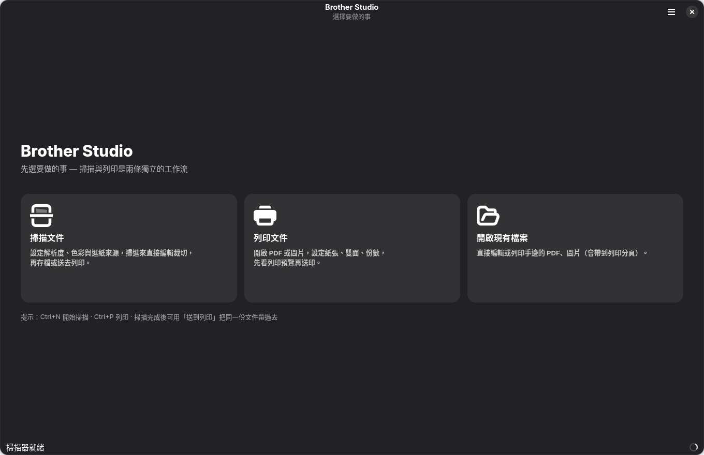
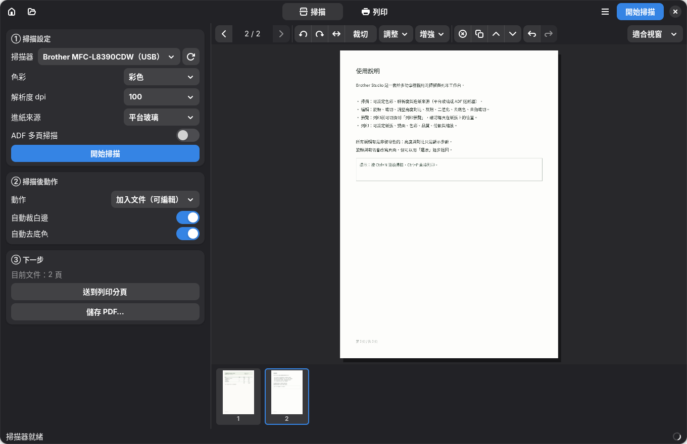
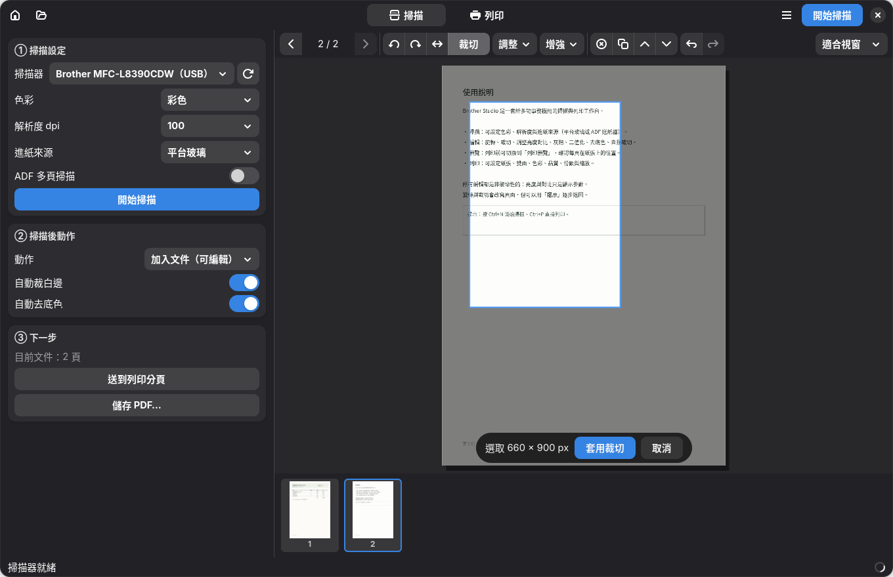
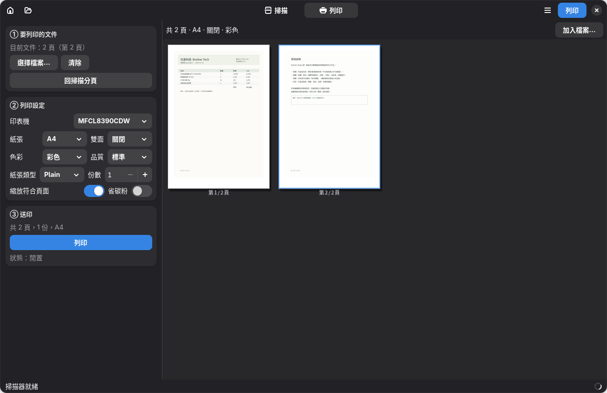

# Brother Studio — 掃描／編輯／列印工作台

給 Brother MFC-L8390CDW 用的桌面程式（GTK4 + Python，原生視窗）。

**掃描和列印是兩條獨立的工作流，從首頁分開**，不會擠在同一頁設定裡。



---

## 啟動

```bash
# 命令列
~/brother-mfcl8390cdw-linux/gui/run.sh

# 或 GNOME 應用程式選單搜「Brother Studio」（桌面捷徑已安裝）

# 也可以直接把檔案丟給它（會開在列印分頁）
run.sh 報價單.pdf 掃描.png
```

同一個 App 只會有一個視窗：再次開檔會把檔案送進已開著的視窗。

---

## 流程

```
首頁 ─┬─► 掃描分頁：① 掃描設定 → ② 掃描後動作 → 掃描 → 編輯 → ③ 送列印 / 存 PDF
      ├─► 列印分頁：① 要列印的文件 → ② 列印設定 → ③ 列印（含預覽）
      └─► 開啟現有檔案（→ 直接進列印分頁）
```

兩頁共用同一份文件，所以掃描完按「**送到列印分頁**」就把整份文件帶過去，不用重開。
頂端分頁籤（掃描｜列印）可隨時切換，左上的房子按鈕回首頁。

---

## 掃描分頁



| 卡片 | 內容 |
| --- | --- |
| ① 掃描設定 | 掃描器（USB／網路自動偵測）、色彩、解析度、進紙來源（平台玻璃／ADF 單面／雙面）、ADF 多頁、開始掃描 |
| ② 掃描後動作 | 加入文件（可編輯）／存成 PDF／存成 PNG／直接列印；輸出資料夾、檔名前綴、自動裁白邊、自動去底色 |
| ③ 下一步 | 目前文件頁數、**送到列印分頁**、儲存 PDF… |

中間是編輯器：頁面預覽、縮圖列、編輯工具列。

### 編輯工具

| 功能 | 說明 |
| --- | --- |
| 旋轉左 / 右 | 90°；快捷鍵 `R`（Shift+R 反向） |
| 水平翻轉 | 鏡射 |
| 裁切 | 畫面上拖出要留的框 → 套用裁切（取消或 Esc 退出） |
| 調整 | 亮度／對比滑桿，即時預覽、可重設（**非破壞性**） |
| 增強 → | 灰階／黑白二值化／去底色／自動裁白邊／校正歪斜 |
| 刪除・複製・上移・下移 | 頁面管理 |
| 還原 / 重做 | 每一步都進堆疊 |
| 縮放 | 適合視窗 / 50% / 100% / 150% / 200%；放大後可拖曳平移、滾輪縮放 |



---

## 列印分頁



| 卡片 | 內容 |
| --- | --- |
| ① 要列印的文件 | 頁數與目前頁、選擇檔案…／清除、回掃描分頁 |
| ② 列印設定 | 印表機、紙張、雙面、色彩、品質、紙張類型、份數、縮放符合頁面、省碳粉 |
| ③ 送印 | 摘要（頁數／份數／紙張／單雙面）、列印、佇列狀態 |

右邊就是**列印預覽**：每一頁依所選紙張比例排版、標「第 n / N 頁」，
目前頁用藍框標示；頁數多時可用滾輪翻頁。改紙張或雙面，預覽立刻跟著變。

---

## 鍵盤快捷鍵

| 按鍵 | 動作 |
| --- | --- |
| `Ctrl+1` / `Ctrl+2` / `Ctrl+3` | 首頁 / 掃描分頁 / 列印分頁 |
| `Esc` | 退出裁切 → 回首頁 |
| `Ctrl+N` | 切到掃描分頁並開始掃描 |
| `Ctrl+O` | 開啟檔案 |
| `Ctrl+S` / `Ctrl+Shift+S` | 儲存 PDF / 儲存圖片 |
| `Ctrl+P` | 切到列印分頁 |
| `Ctrl+Z` / `Ctrl+Shift+Z` | 還原 / 重做 |
| `R` / `Shift+R` | 旋轉（掃描分頁） |
| `Delete` | 刪除本頁（掃描分頁） |
| `←` / `→` | 上一頁 / 下一頁（掃描分頁） |

---

## 檔案與設定

| 位置 | 內容 |
| --- | --- |
| `~/.config/brother-studio/config.json` | 所有設定（掃描參數、輸出資料夾、列印選項、上次用的裝置、裝置快取） |
| `/tmp/brother-studio/scan/` | 掃描暫存頁面 |
| `/tmp/brother-studio/print/` | 送印前組好的 PDF |
| `~/.local/share/applications/brother-studio.desktop` | 桌面捷徑 |

---

## 已知限制

* **沒有 OCR**（本機沒裝 tesseract），所以還不能做「可搜尋 PDF」。
* **`scanimage -L` 只列網路那台**：本機 USB 的 `brother5` 不會被列出（見主 README §7）。
  程式會自動探測 USB 並記住，選單裡看得到。
* **列印驅動是 PPD 架構**，CUPS 2.4 會提示 `Printer drivers are deprecated`；目前正常。
* 編輯是「夠用」等級：沒有套索、圖章、文字方塊，也不能一次旋轉整份文件。
* 列印預覽是依紙張比例的示意排版，不是點陣級 WYSIWYG。
* 主視窗關掉後重新開啟，**不會自動載回剛才那份未儲存的文件**（設定會記住，文件不會）。

---

## 開發者備註

```
gui/
├── brother_studio.py   # 入口：Adw.Application（HANDLES_OPEN）、示範文件、截圖模式
├── bs_ui.py            # HomePage / ScanPage / PrintPage / StudioWindow + cairo 畫布
├── bs_core.py          # 掃描（scanimage）、列印（lp）、影像編輯、文件模型（無 GTK 依賴）
├── run.sh、brother-studio.desktop
└── docs/               # 截圖
```

`bs_core.py` 可單獨測試：

```bash
cd gui
python3 -c "import bs_core as C; print(C.list_devices()); print(C.default_printer())"
```

開發參數：

```bash
python3 brother_studio.py --demo                        # 示範文件（不需要掃描器）
python3 brother_studio.py --no-anim                     # 關掉轉場（遠端桌面／截圖）
python3 brother_studio.py --demo --screenshot out.png   # 把視窗渲染成 PNG
```

> `--screenshot` 用 `Gtk.WidgetPaintable` + `Gsk.Renderer` 自繪成 PNG（本機沒有截圖工具）。
> 沒有 `--no-anim` 會拍到轉場中的舊畫面；另外截圖模式會用 `NON_UNIQUE`，
> 否則新行程會被既有視窗接管而收不到 `activate`。

### 設計取捨

* **掃描與列印分頁、共用文件**：設定分開（不會互相干擾），但文件是同一份，
  掃完能直接送去列印，不用存檔再開。
* **首頁分流**：一開始就決定要做什麼，避免單頁塞滿十幾個控制項。
* **掃描走 `scanimage` 子行程**：`--batch` 對 ADF 多頁支援完整；不必額外裝 python-sane。
* **列印走 `lp`**：沿用已裝好的 Brother CUPS 佇列，選項直接對應 PPD（PageSize / Duplex / BRMonoColor…）。
* **預覽用 cairo 自繪**：裁切框、縮放、平移都在同一座標系，不必換算 Gtk.Picture 在 ScrolledWindow 的位置。
* **裝置有鎖**：SANE 一次只能一個行程開啟，`bs_core` 用 `threading.Lock` 把掃描、
  能力探測、USB 探測排隊，避免互相打斷（否則會看到 `Invalid argument`）。
